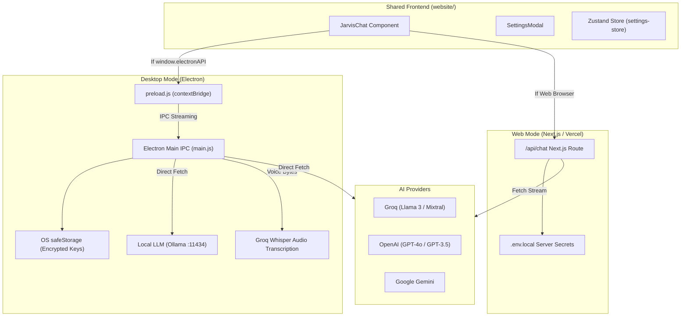

# JARVIS Full System Architecture & Project Walkthrough

## Executive Summary
**JARVIS** is an AI assistant and productivity workspace engineered as a dual-runtime application:
1. **Web Client** (`website/`): A Next.js 14 web application deployable on platforms like Vercel with server-managed AI credentials and modern responsive UI.
2. **Desktop Client** (`electron-main/`): A cross-platform Electron application that bundles the statically exported frontend, providing hardware acceleration, encrypted OS-level credential storage (`safeStorage`), Groq Whisper audio transcription, and zero-CORS streaming directly to LLM providers or local Ollama instances.

---

## Architecture Diagram

---

## Core Components Breakdown

### 1. Web Application (`website/`)
- **Framework**: Next.js 14 (App Router), React 18, TypeScript, Tailwind CSS.
- **Entrypoints**:
  - [`page.tsx`](file:///e:/Abdulrahman/jarvis/website/src/app/page.tsx): Main application wrapper rendering `JarvisChat`.
  - [`JarvisChat.tsx`](file:///e:/Abdulrahman/jarvis/website/src/components/JarvisChat.tsx): Unified conversation interface managing chat turns, Markdown/code rendering with copy controls, speech recognition, and multilingual prompts.
  - [`route.ts`](file:///e:/Abdulrahman/jarvis/website/src/app/api/chat/route.ts): Streaming Next.js API endpoint for web users using server-configured keys.
  - [`settings-store.ts`](file:///e:/Abdulrahman/jarvis/website/src/lib/settings-store.ts): Zustand store persisting client-side preferences (theme, typography, system prompts, model parameters) to `localStorage`.
- **Exporting**: Configured with `output: 'export'` support so the built output in `website/out` can be packaged directly into Electron.

### 2. Desktop Application (`electron-main/`)
- **Shell**: Electron 30 with context isolation and sandboxed renderer communication.
- **Key Modules**:
  - [`main.js`](file:///e:/Abdulrahman/jarvis/electron-main/main.js):
    - Embeds a local HTTP server serving `website/out`.
    - Implements IPC channels: `jarvis:chat:start`, `jarvis:chat:cancel`, `jarvis:keys:set`, `jarvis:keys:status`, `jarvis:audio:transcribe`.
    - Manages OS keychain-level encryption via `safeStorage` so personal API keys are never exposed in plaintext or returned to renderer JS.
  - [`preload.js`](file:///e:/Abdulrahman/jarvis/electron-main/preload.js): Exposes the safe `window.electronAPI` bridge to the frontend.
  - [`build-website.js`](file:///e:/Abdulrahman/jarvis/electron-main/build-website.js): Automates static compilation and export of `website/` before packaging.
  - [`offline.html`](file:///e:/Abdulrahman/jarvis/electron-main/offline.html): Graceful offline/loading fallback window.

---

## Supported AI Providers & Models
1. **Groq**: Ultra-fast Llama-3 / Mixtral inference + Whisper audio transcription. Auto-detected via `gsk_` prefix.
2. **OpenAI**: GPT-4o / GPT-4 Turbo models. Auto-detected via `sk-` prefix.
3. **Google Gemini**: Gemini 1.5 / 2.0 Flash / Pro models. Auto-detected via `AIza` prefix.
4. **Local / Ollama**: Privacy-first local inference connecting to `http://localhost:11434` without cloud keys.

---

## Multilingual Support
JARVIS natively provides prompt instructions and welcome greetings in:
- English
- Urdu (Nastaliq script)
- Roman Urdu (Pakistani Latin script)
- Hindi & Hinglish
- Arabic, French, Spanish, German, Japanese, and Chinese
