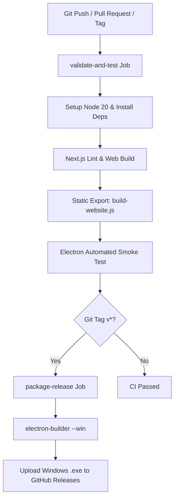

# JARVIS Continuous Integration & Testing Pipeline

## Overview
This document defines the development, testing, and continuous delivery workflows for the JARVIS monorepo. It establishes zero-friction local testing commands for Electron without requiring installer builds, while separating website development from the native desktop client.

---

## Command Matrix

| Command | Action | Use Case |
| :--- | :--- | :--- |
| `npm run dev:web` / `npm run dev` | Runs Next.js website dev server at `http://localhost:3000` | Testing and designing the Product Landing Page |
| `npm run dev:electron` / `npm run test:electron` | Launches Electron in interactive test mode with DevTools enabled | Testing the desktop app, IPC streaming, audio, and settings without installing |
| `npm run test:electron:rebuild` | Forces a fresh export of `website/out` and launches Electron | Testing latest UI changes inside Electron |
| `npm run test:smoke` | Runs headless verification of Electron window, IPC, and server | Automated health check for local and CI |
| `npm test` | Runs web build, desktop export, and smoke test in sequence | Pre-commit sanity verification |
| `npm run package-win` | Builds production `.exe` NSIS installer into `electron-main/dist/` | Production distribution releases only |

---

## Local Development & Testing Architecture

### 1. Interactive Desktop Runner (`dev-runner.js`)
Located at [`electron-main/dev-runner.js`](file:///e:/Abdulrahman/jarvis/electron-main/dev-runner.js):
- Checks if the bundled static export [`website/out/index.html`](file:///e:/Abdulrahman/jarvis/website/out/index.html) exists.
- If missing or if `--rebuild` is passed, automatically invokes `build-website.js` first.
- Spawns the local Electron binary with `OPEN_DEVTOOLS=true` and `--devtools` flag.
- Enables instant UI pairing, DevTools debugging, and hot testing without any installer setup.

### 2. Automated Smoke Verification (`smoke-test.js`)
Located at [`electron-main/smoke-test.js`](file:///e:/Abdulrahman/jarvis/electron-main/smoke-test.js):
- Boots Electron with `--test-smoke`, `--no-sandbox`, and `--disable-gpu`.
- Asserts that IPC listeners register, safeStorage is evaluated, the local HTTP static server begins listening on `127.0.0.1`, and the main window opens.
- Cleanly exits with code `0` after 2.5 seconds.
- Fails with code `1` if a timeout (35 seconds) or uncaught exception occurs.

---

## GitHub Actions CI/CD Pipeline

Defined in [`.github/workflows/ci.yml`](file:///e:/Abdulrahman/jarvis/.github/workflows/ci.yml):

### Key Stages
1. **Validation & Test**:
   - Executes on all branches and PRs on `windows-latest`.
   - Validates TypeScript typing and builds both Next.js app and Electron export.
   - Runs headless Electron smoke test verifying clean exit.
2. **Release Distribution**:
   - Triggers on semantic version tags (`v*`).
   - Compiles production NSIS installer.
   - Automatically generates release notes and attaches Windows `.exe` to the GitHub Release.
