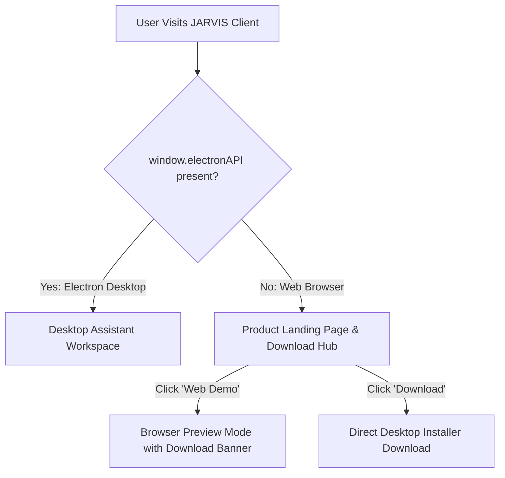

# JARVIS Website Landing Page & Desktop Architecture

## Overview
The JARVIS web platform serves as an editorial product landing page and distribution hub. Visitors learn about JARVIS capabilities, explore native desktop architecture, inspect offline local model workflows, and download the native desktop application for Windows, macOS, and Linux.

---

## Architectural Segregation

### Runtime Environment Detection
In [`website/src/app/page.tsx`](file:///e:/Abdulrahman/jarvis/website/src/app/page.tsx):
- **Desktop Runtime (`Boolean(window.electronAPI)`)**: Mounts `<JarvisChat />` directly with full access to local IPC streaming, native audio drivers, and OS SafeStorage.
- **Web Browser Runtime (`!window.electronAPI`)**: Mounts `<LandingPage />` showcasing core features, hardware privacy benefits, Ollama local model support, and direct installer downloads. Includes an optional interactive browser preview mode (`Web Demo`).

---

## Color & Design Synchronization

Both the Electron Desktop Client and Web Landing Page adhere to unified visual tokens:

| Token | Light Mode Value | Purpose |
| :--- | :--- | :--- |
| `--accent` | `#dc2626` | Canonical JARVIS Crimson Red |
| `--accent-hover` | `#ef4444` | Interactive hover state |
| `--background` | `#fffafa` / `#faf8f5` | Warm editorial porcelain |
| `--card-bg` | `#ffffff` | Clean card surfaces |
| `--card-border`| `rgba(185, 28, 28, 0.13)` | Crisp low-contrast red/zinc borders |
| `--foreground` | `#18181b` | High-contrast charcoal text |

### Legacy Cyan Sanitization
To prevent stale browser `localStorage` entries (from legacy frontends) from loading neon cyan buttons (`#00f0ff`, `#06b6d4`, `#22d3ee`):
1. **Bootstrap Script** in [`website/src/app/layout.tsx`](file:///e:/Abdulrahman/jarvis/website/src/app/layout.tsx) checks and normalizes legacy cyan values back to `#dc2626`.
2. **Store Hydration** in [`website/src/lib/settings-store.ts`](file:///e:/Abdulrahman/jarvis/website/src/lib/settings-store.ts) sanitizes `accentColor` during Zustand merge.
3. **Component Guard** in [`website/src/components/JarvisChat.tsx`](file:///e:/Abdulrahman/jarvis/website/src/components/JarvisChat.tsx) rejects legacy cyan hex values.

---

## Landing Page Components

- **Announcement Bar**: Displays current release version with direct download shortcut.
- **Header Navigation**: Features anchor links (`#features`, `#preview`, `#privacy`, `#local-models`, `#faq`), GitHub repository link, and primary download CTA.
- **Hero Section**: High-impact editorial headline, value proposition, Windows x64 download button, and trust badges (DPAPI, Live Voice, Local Models, Multi-Session).
- **Simulated Desktop Window**: Pixel-perfect preview of JARVIS Desktop with code-switched Roman Urdu/English interaction and local Llama 3.2 engine.
- **Bento Grid**: 6 technical pillars (Multilingual voice engine, OS SafeStorage, Offline local models, Persistent sessions, Desktop ergonomics, Anti-AI editorial craft).
- **Architecture Matrix**: Direct comparison between JARVIS Desktop and generic cloud chatbots.
- **Download Hub**: Dedicated cards for Windows (`.exe`), macOS (`.dmg`), and Linux (`.AppImage`, `.deb`).
- **Interactive FAQ**: Answers regarding open-source licensing, offline execution, and data privacy.
